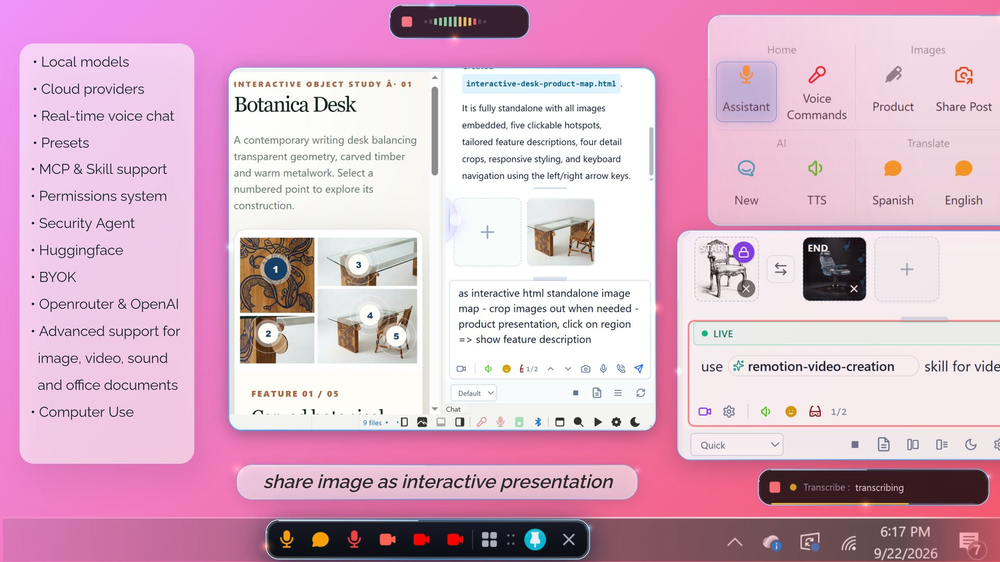
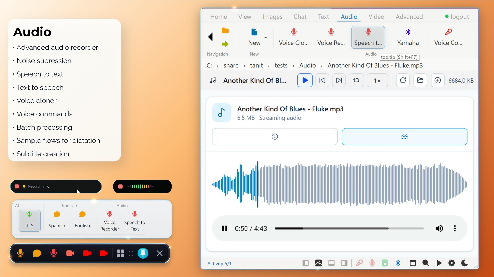
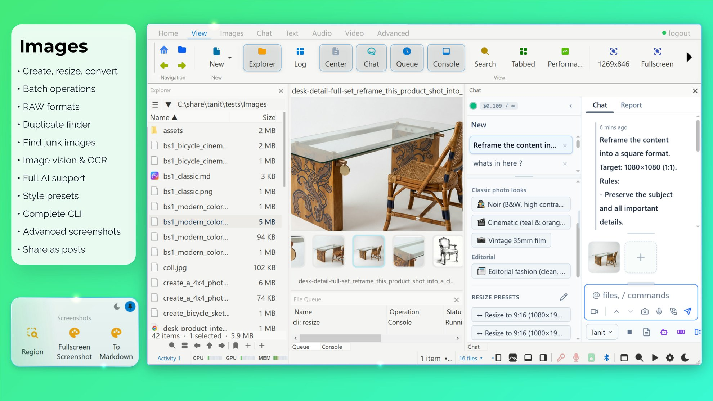
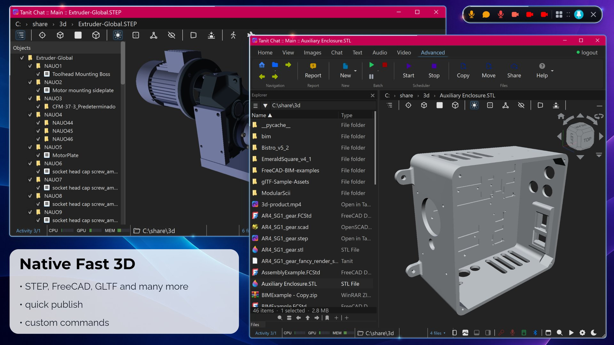
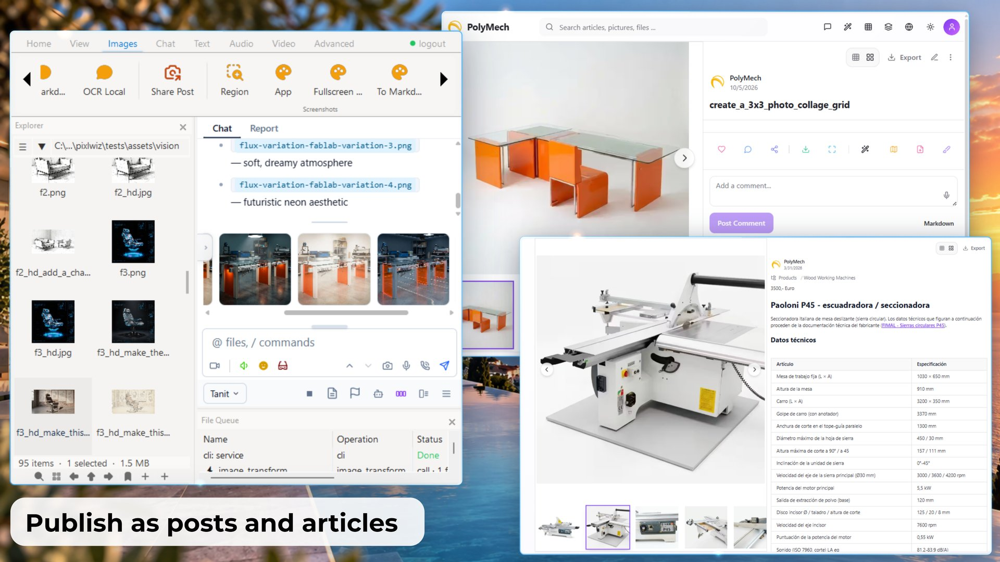
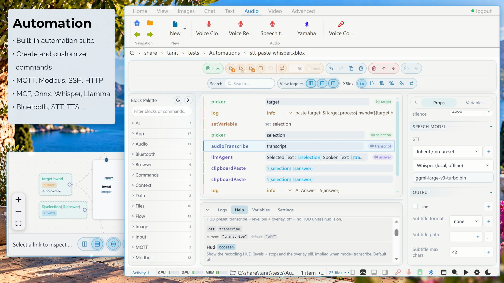
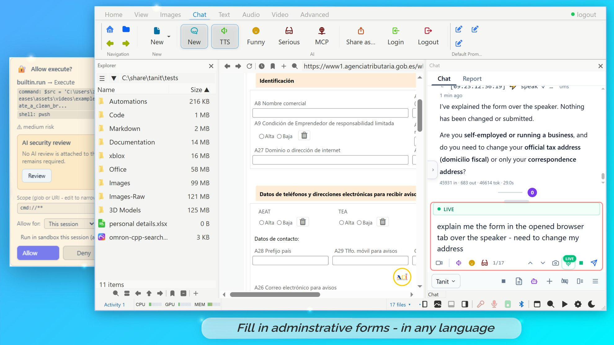
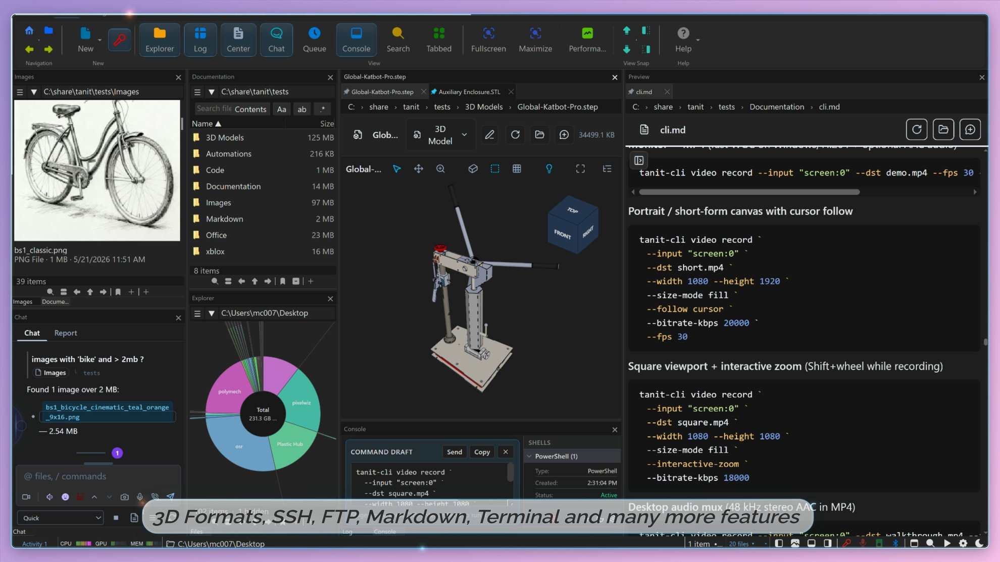

# Tanit Chat — screenshots

---

## AI

**Header:** Route each capability to the right model  
**Caption:** Text, planning, vision, OCR, image generation, transcription, and speech each use a different local or cloud provider — never one vendor for everything.

---

## Voice

**Header:** Talk instead of typing  
**Caption:** Voice is a local capability first. Cloud realtime routing is opt-in when you want it.

---

## Images

**Header:** Inspect, batch, generate  
**Caption:** Vision can stay on the device. Generation can go to the cloud. You choose per job.

---

## 3D

**Header:** Blazing fast 3D preview, opens 40MB STEP in less than 2 seconds  
**Caption:** Supports STEP, STL, FBX, VTK, USD, DXF, FreeCAD, OBJ, GLTF, GLB, and OpenSCAD.

---

## Office

**Header:** Office and PDF  
**Caption:** Open a spreadsheet or a deck without a separate office suite.

---

## Video

**Header:** Play, capture, convert  
**Caption:** Review clips in place, capture when you start it, convert in batch — same workspace as chat.

---

## Browser Use

**Header:** Open Tanit beside any page, publish browser work as articles  
**Caption:** Search, read, fill, translate, and talk without leaving the page. A task can start in Chrome and finish in a local file or an XBlox flow.

---

## Share

**Header:** Create and share from Tanit  
**Caption:** Publish a report, an article, a set of pictures, or a file. Tanit uploads it to your account and gives you a link you can send.

---

## Automation

**Header:** Turn a chat into a command  
**Caption:** When the task repeats, save the successful process and run it on the next selection.

---

## Launcher

**Header:** Published in the launcher  
**Caption:** A finished flow becomes a command you can run without opening the editor.

---

## Browser-use from a command

**Header:** Browser-use from a command  
**Caption:** Drive a page or form with the same flow that started as a chat.

---

## Security

**Header:** Approve every action  
**Caption:** Complete GPO support to lockdown providers, models, and interface. Security agent consent: once, task, session, limited time, always, or never.

---

## Files

**Header:** The file panel beside the viewer  
**Caption:** Open a folder on this PC, connect a phone, browse SSH or FTP, preview files, copy between locations, or switch to a disk-usage view.

---

